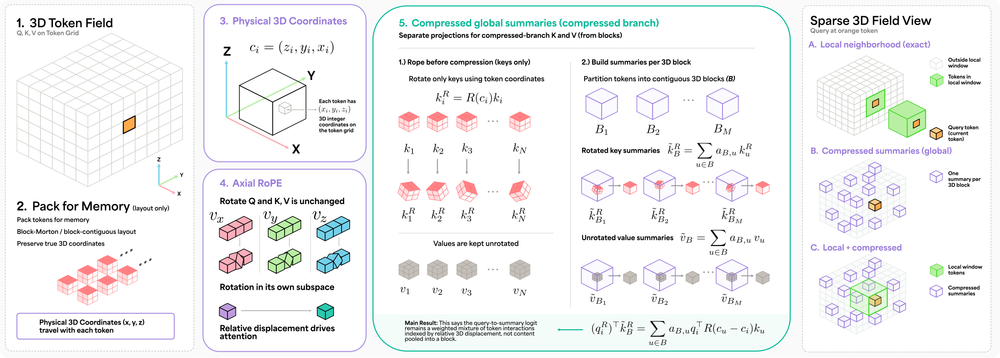

<div align="center">

# PACK3D

### Geometry Matters in Packed 3D Attention

**NeurIPS 2026**

Amil Khan · Anantajit Subrahmanya · B.S. Manjunath<br>
University of California, Santa Barbara

[](https://arxiv.org/abs/2610.38694)
[](https://amilworks.github.io/Pack3D/)
[](https://github.com/amilworks/Pack3D/actions/workflows/ci.yml)
[](LICENSE)
[](pyproject.toml)
[](https://pytorch.org)

[**Paper**](https://arxiv.org/abs/2610.38694) ·
[**Project page**](https://amilworks.github.io/Pack3D/) ·
[**Quickstart**](#quickstart) ·
[**The repack test**](#the-repack-test) ·
[**Reproduce the paper**](#reproduce-the-paper) ·
[**Citation**](#citation)

</div>

<p align="center">
  
</p>

<p align="center"><sub><b>Figure 1.</b> Tokens are packed into memory (2) but keep their 3D coordinates (3).
Queries and keys are rotated with axial RoPE at those coordinates (4). Keys are rotated <i>before</i>
they are pooled into block summaries (5). Each query attends exactly to its neighborhood and to every summary (right).</sub></p>

Packing a 3D volume into a token sequence gives every token two indices: a **coordinate** in the
volume and a **position in memory**. Raster, Morton and block layouts change the position and leave
the coordinate alone. An attention layer that reads position from the sequence index can learn the
storage order instead of the object, and accuracy on the training layout cannot tell you which one
it learned.

**PACK3D** is a local–global attention operator that reads position from coordinates. Each query
attends exactly to a coordinate-defined 3D neighborhood and, through compressed summaries, to the
whole field. Queries and keys are rotated with axial RoPE at their `(z, y, x)` grid coordinates, and
keys are rotated before they are pooled. If a repack carries each token's coordinate, neighbors,
summary memberships and within-block slot along with it, PACK3D's outputs move with the tokens and
nothing else changes.

This repository contains:

- **`pack3d`**, a small PyTorch package: the attention layer, its geometry and repacking tools, a
  readable reference implementation, and an optional Triton GPU backend.
- **`reproduce/`**, the 45 PACK3D training recipes for the paper's microscopy (Allen-15) and Medical
  Segmentation Decathlon (MSD) experiments, with the scripts that train and evaluate them.
- **`results/`**, frozen results with checksums, including the per-seed data behind the table below.
- **`website/`**, the [project page](https://amilworks.github.io/Pack3D/).

## Results

**Allen-15** predicts Allen-generated masks of 15 tagged structures in 3D images of WTC-11 hiPSC
cells, from target fluorescence, brightfield and DNA channels, at 262,144 tokens per crop. On it,
PACK3D and a matched control that applies RoPE at the packed sequence index reach comparable Dice on
the layout they were trained on. A **pure repack** stores the same validation crops in a new memory
order and carries each token's coordinate, neighbors, summary memberships and within-block slot with
it. It separates the two models:

| Positional encoding | Training layout | After a pure repack | Change |
| :--- | ---: | ---: | ---: |
| **PACK3D**: axial RoPE at grid coordinates | 0.8247 | 0.8248 | **+0.0001** |
| Same operator, RoPE at the packed sequence index | 0.8229 | 0.7750 | **−0.0479** |

<sub>Mean validation macro Dice over six matched seeds. Each model's best checkpoint was chosen on
the training layout and evaluated unchanged, with no retraining, on all 120 validation crops before
and after the repack. The packed control loses Dice in all six seeds. Per-seed values:
[`results/allen15_repacking/seed_metrics.csv`](results/allen15_repacking/seed_metrics.csv).</sub>

The paper also reports:
- **MSD Heart and Spleen.** Sequence indexing again changes more predictions under repacking, at
  little cost in Dice.
- **A matched 3D U-Net.** PACK3D's best Dice is higher than a closely parameter-matched 3D U-Net's by
  0.009, in all six seed pairs: a modest advantage in one matched comparison, not a ranking of
  attention above convolution.
- **Cost.** A full PACK3D layer runs within 7–31% of window-attention latency while adding a global
  pathway.

## Installation

PACK3D needs Python 3.11 or newer and PyTorch 2.11 or newer. Install the
[PyTorch build for your machine](https://pytorch.org/get-started/locally/) first, then:

```bash
git clone https://github.com/amilworks/Pack3D.git
cd Pack3D
pip install -e .
```

Optional extras install with `pip install -e ".[extra]"`, for example `pip install -e ".[triton]"`:

| Extra | Adds | Needed for |
| :--- | :--- | :--- |
| `triton` | Triton 3.6 or newer | The GPU backend (Linux, NVIDIA compute capability 8.0 or newer) |
| `reproduce` | MONAI, NumPy, SciPy, NiBabel, tifffile, imagecodecs, PyYAML | The paper's training and evaluation scripts |
| `dev` | pytest, Ruff, build, twine, markdown-it-py, PyYAML | Tests and release checks |

## Quickstart

```python
import torch
from pack3d import PACK3DAttention, build_layout

# A 16 x 16 x 16 token grid in 2 x 2 x 2 blocks; every 4 block summaries are pooled into one.
layout = build_layout((16, 16, 16), block_shape=(2, 2, 2), pool_size=4)
attention = PACK3DAttention(64, heads=4, kv_heads=2, head_dim=16)

field = torch.randn(2, 16, 16, 16, 64)           # [batch, Z, Y, X, channels]
tokens = layout.pack(field)                      # [batch, 4096, 64], in memory order
out = layout.unpack(attention(tokens, layout))   # back to [batch, Z, Y, X, channels]
```

The `layout` carries everything the layer needs to know about geometry: each packed row's
`(z, y, x)` coordinate, its 3 × 3 × 3 neighborhood, and the block summaries it belongs to. The layer
never reads a token's memory position. The layer takes `[batch, tokens, channels]` and returns the
same shape. Its `block_volume` (default 8) must equal the number of tokens in a block, so if you
change `block_shape`, change it too: for example, `block_volume=64` for `(4, 4, 4)` blocks.

To run on an NVIDIA GPU, install the `triton` extra, build the layer with `backend="triton"`, and
move the layer, the layout and the inputs to the GPU:

```python
attention = PACK3DAttention(64, heads=4, kv_heads=2, head_dim=16, backend="triton").cuda()
layout = layout.to("cuda")
tokens = tokens.cuda()
```

[docs/backends.md](docs/backends.md) lists what each backend supports.

More [examples](examples/README.md), each of which runs on a CPU in seconds:

```bash
python examples/minimal_attention.py        # forward and backward on a small field
python examples/repacking_equivariance.py   # outputs and gradients survive a repack
python examples/repack_test.py              # the repack test, with and without coordinates
```

## The repack test

The paper's practical takeaway is a check that any model whose tokens carry coordinates can run.
Permute the tokens in memory and carry their metadata along. Run the trained model unchanged, put the
outputs back in spatial order, and compare. In PACK3D, `TokenLayout.repack` carries the metadata:

```python
permutation = torch.randperm(layout.geometry.num_tokens)
repacked = layout.repack(permutation)        # new row i is old row permutation[i]

before = attention(tokens, layout)
after = attention(tokens[:, permutation], repacked)[:, permutation.argsort()]
print((before - after).abs().max().item())   # 0.0, up to floating-point rounding
```

[`examples/repack_test.py`](examples/repack_test.py) runs this twice with the same weights: once
with RoPE at coordinates, once with RoPE at the packed sequence index:

```text
RoPE at coordinates (PACK3D)  largest output change after repacking: 0.0e+00
RoPE at sequence index        largest output change after repacking: 1.7e-01
```

A large change means the outputs depend on the storage order. A change near zero means only that this
repack left them unchanged: one permutation is a stress test, not a guarantee for every layout. To
run the test on your own model, carry every piece of per-token metadata it uses: coordinates, masks,
neighborhoods, block or group memberships, and slot identities. The
[method walkthrough](docs/method.md#repack-without-changing-the-operator) shows the details.

## How it works

1. **Pack.** Tokens can be stored in any order. Each keeps its `(z, y, x)` grid coordinate.
2. **Rotate.** Queries and keys get axial RoPE at their coordinates. Values are not rotated.
3. **Attend locally.** Each query gets exact softmax attention over its coordinate-defined
   neighborhood (3 × 3 × 3 by default). Adjacency in memory plays no part.
4. **Summarize.** Inside each fine block, a learned softmax weights the rotated keys and unrotated
   values into one summary. The weights depend on the block's content, not on the query. Groups of
   fine summaries are then averaged into the final summaries.
5. **Attend globally and combine.** Each query attends to every final summary, and a learned gate
   adds this global output to the local one.

Because keys are rotated before pooling, the logit between query $i$ and summary $g$ is a weighted
sum of query–key terms, each evaluated at a summarized token's displacement from the query:

```math
\bigl(R(c_i)\,q_i\bigr)^{\top}\,\tilde k_g
\;=\; \sum_{u \in S_g} A_{gu}\; q_i^{\top} R(c_u - c_i)\, k_u
```

Here $R(c)$ is the axial rotation at coordinate $c$, $S_g$ is the set of tokens summary $g$ pools,
and $A_{gu}$ are the realized pooling weights. The identity describes the logit; compression is still
lossy. **Proposition 2** of the paper states what a repack must carry for the whole operator to move
with its tokens: coordinates, validity, local neighborhoods, both stages of summary membership, and
within-block slots. Switching to a different block partition, for example from `raster_block` to
`native_block_morton`, is a different intervention, and Proposition 2 does not cover it.

To go deeper, read the [method walkthrough](docs/method.md) for a worked example, the
[theory](docs/theory.md) for the derivations, and the [code guide](docs/code_guide.md) for which
function implements which equation.

## Backends

| Backend | Select with | Runs on | Use it for |
| :--- | :--- | :--- | :--- |
| Reference | `backend="reference"` (default) | CPU or GPU, small fields | Reading the operator, tests, examples |
| Streamed Triton | `backend="triton"` | NVIDIA GPU, compute capability 8.0 or newer | GPU execution of the same operator, with an explicit backward pass |
| Paper backend | the scripts in `reproduce/` | CUDA GPU; CPU for the smoke test | Reproducing the reported experiments and loading their checkpoints |

The paper's numbers come from the paper backend. The streamed Triton backend is newer. It matches the
reference in correctness tests on an H200 GPU, but it was not used to train, evaluate or time any
reported model, and the paper makes no speed claim for it. Unsupported inputs raise an error instead
of falling back silently.

## Reproduce the paper

There are three levels, from seconds to GPU-days. First install the extras, pinned to the versions
the paper's runs used (the pins need Python 3.12 or newer):

```bash
pip install -e ".[dev,reproduce]" -c reproduce/constraints-tested.txt
```

**1. Run the tests.** GPU tests are opt-in, and they skip on a CPU.

```bash
python -m pytest -q
```

**2. Recompute the results table** from the frozen per-seed data. This needs no dataset and no GPU.
It prints the six-seed means and the exact paired sign-flip test across seeds (p = 0.03125,
two-sided).

```bash
python reproduce/aggregate.py
```

**3. Train and evaluate.** A dataset-free smoke test runs the paper's training pipeline on synthetic
crops in seconds on a CPU. It checks the wiring, not the scientific result:

```bash
python reproduce/data/make_smoke_data.py --output artifacts/smoke-data
python reproduce/train.py --config reproduce/configs/smoke.yaml \
  --manifest artifacts/smoke-data/manifest.json --data-root artifacts/smoke-data \
  --output artifacts/smoke-train --device cpu
python reproduce/evaluate.py --config reproduce/configs/smoke.yaml \
  --checkpoint artifacts/smoke-train/results/checkpoints/run/best.pt \
  --manifest artifacts/smoke-data/manifest.json --data-root artifacts/smoke-data \
  --output artifacts/smoke-eval --device cpu
```

Training prints nothing when it succeeds; it writes its checkpoints to
`artifacts/smoke-train/results/checkpoints/run/`. Evaluation prints its metrics and saves them to
`artifacts/smoke-eval/metrics.json`. The scripts never overwrite results, so each run needs new
output folders.

The 45 PACK3D recipes are in [`reproduce/configs/`](reproduce/configs/): 27 for Allen-15 and 9 each
for MSD Heart and Spleen. [`reproduce/README.md`](reproduce/README.md) covers the full runs, the
pure-repack evaluation, and the layout switch. Training code for the U-Net and the auxiliary
experiments is not included. Datasets and trained checkpoints are not included either;
[`reproduce/data/README.md`](reproduce/data/README.md) describes the expected data format and the
paper's preprocessing protocol.

[docs/reproducibility.md](docs/reproducibility.md) maps each family of results in the paper to the
files and commands that support it.

## Repository layout

```text
Pack3D/
├── src/pack3d/        the package: geometry, axial RoPE, compression, reference, attention layer
│   └── backends/      the optional streamed Triton backend
├── examples/          small runnable examples (CPU, seconds)
├── tests/             mathematical identities, geometry, repacking, gradients; GPU tests opt-in
├── docs/              method walkthrough, theory, code guide, backends, reproducibility
├── reproduce/         paper recipes, data contract, training and evaluation, the paper backend
├── results/           frozen per-seed and camera-ready metrics, with checksums
├── benchmarks/        a correctness-gated timing harness for the attention layer
├── tools/             release and website checks
└── website/           the project page, deployed with GitHub Pages
```

## Documentation

| Read | To learn |
| :--- | :--- |
| [Method walkthrough](docs/method.md) | The operator on a 4 × 4 × 4 field, tensor by tensor |
| [Theory and implementation contract](docs/theory.md) | The relative-logit identity, packing equivariance, and what they do not imply |
| [Reading the code](docs/code_guide.md) | Which function implements which equation, and its test |
| [Execution backends](docs/backends.md) | What the reference and Triton backends support |
| [Reproducibility map](docs/reproducibility.md) | How each family of results can be checked or rerun |
| [Release validation](docs/validation.md) | The checks run for this release, and how to repeat them |
| [Corrections](docs/corrections.md) | Corrections made after review, carried into this code |
| [The project website](docs/pages.md) | How the project page is deployed |

## Scope and limitations

- **The headline result is robustness to storage order**, not higher accuracy on a fixed layout. On
  the training layout, PACK3D and the packed-sequence control reach comparable Dice.
- **The medical models are shallow**, with small validation populations and crops centered on known
  foreground. They show layout sensitivity with little accuracy consequence.
- **Best checkpoints and reported scores share one validation set.** These are validation results,
  not held-out test scores.
- **The U-Net margin is modest**, and Swin UNETR and nnFormer were not run.
- **The global branch is still quadratic** at a fixed compression ratio, and window attention is
  faster per layer.
- **This is research code.** It is not validated for clinical or scientific decisions.

The paper's limitations paragraph has the complete list.

## Citation

If you use PACK3D, please cite the paper:

```bibtex
@inproceedings{khan2026geometry,
  title         = {Geometry Matters in Packed {3D} Attention},
  author        = {Khan, Amil and Subrahmanya, Anantajit and Manjunath, B. S.},
  booktitle     = {Advances in Neural Information Processing Systems},
  year          = {2026},
  eprint        = {2610.38694},
  archivePrefix = {arXiv}
}
```

GitHub's **Cite this repository** button reads [CITATION.cff](CITATION.cff).

## License

The code is released under the [MIT License](LICENSE). The datasets used in the paper are not
included and remain under their own terms: the Allen Institute for Cell Science WTC-11 hiPSC
Single-Cell Image Dataset v1, the Medical Segmentation Decathlon (Heart and Spleen), and
NoduleMNIST3D from MedMNIST.
[THIRD_PARTY_NOTICES.md](THIRD_PARTY_NOTICES.md) lists the external dependencies and the
third-party fonts and library that the website includes.

## Contributing and contact

Bug reports and questions are welcome as [GitHub issues](https://github.com/amilworks/Pack3D/issues).
[CONTRIBUTING.md](CONTRIBUTING.md) explains how to set up a development environment and run the
checks. You can reach the authors at `{amil, anantajit, manj}@ucsb.edu`.
